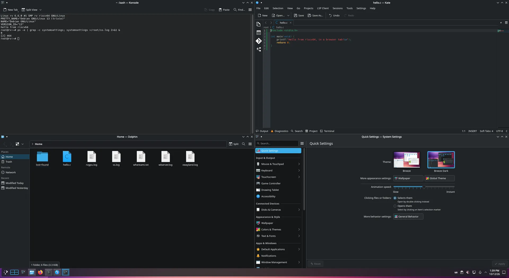
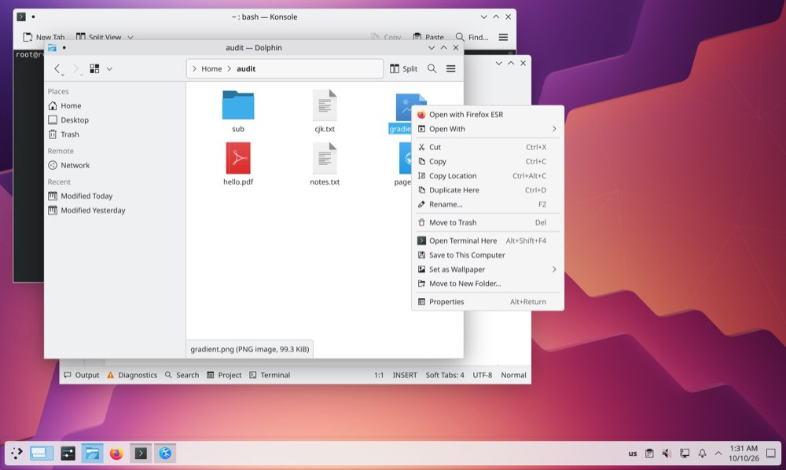
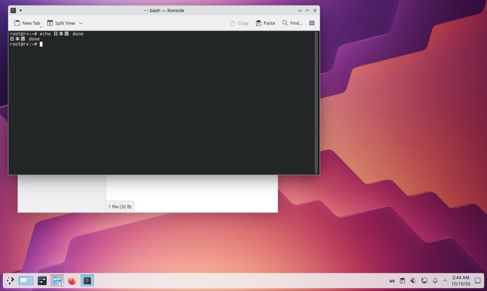
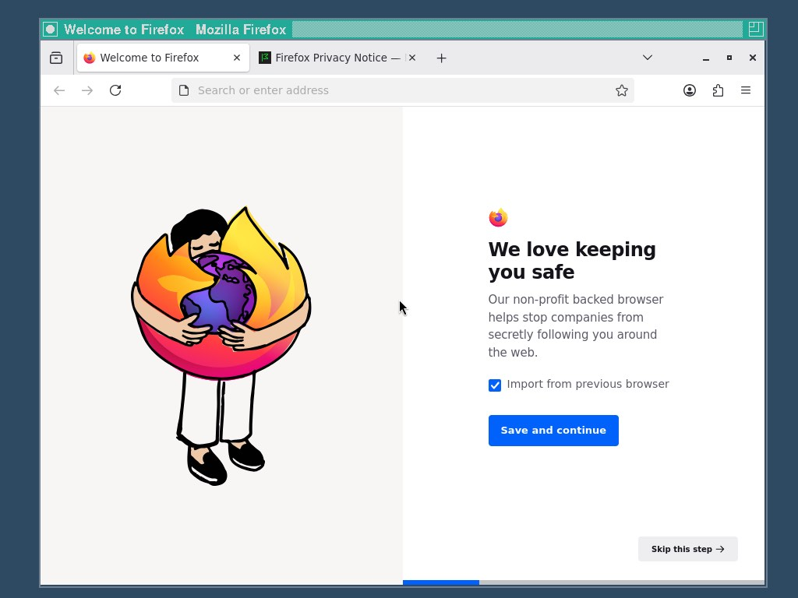

# rvwasm



*Konsole, Kate, Dolphin and System Settings, running in a Chrome tab. Nothing here is a video stream: every program runs on the visitor's own computer.*

**A Linux desktop that runs inside a browser tab.** rvwasm boots Debian (riscv64) with KDE Plasma in Chrome:
Konsole, Dolphin, Kate, System Settings, Firefox, Chromium, `apt-get install`, sound, GPU drawing and hardware
video decoding. Nothing is streamed from a server: the machine runs on the visitor's own computer, inside the
page. The server only hands out the files and, optionally, rvRelay (a restricted network relay).

## How it was made

rvwasm was designed and directed by Swap and built with [Claude](https://www.anthropic.com/claude), Anthropic's AI
model, through [Claude Code](https://claude.com/claude-code). Most of the code, the build tooling and the
documentation were written by Claude agents (Opus, Sonnet and Fable models); Swap chose the direction, tested every
build in the browser and decided what shipped. Claude is a tool used to build rvwasm, not part of it: nothing from
Claude ships in the release, and it is not free software (unlike everything listed under Credits).

## Screenshots



*Dolphin and its context menu (open with, copy, trash, "Save to This Computer" to download a file to the visitor's own disk).*



*Typing Japanese, Chinese or Korean works: input methods and fonts are in the system.*



*Firefox ESR, an unmodified Debian riscv64 program, translated to WebAssembly as it runs (here on the lighter IceWM desktop).*

## Architecture

```
 Browser tab (the hardware)
 ├─ display ........ draws the windows (WebGL)
 ├─ GPU executor ... runs the machine's OpenGL on WebGL2 / WebGPU
 ├─ video decoder .. WebCodecs (the computer's hardware decoder)
 ├─ audio player ... AudioWorklet
 └─ network ........ WebSocket to rvRelay
        │  one block of shared WebAssembly memory
 Linux kernel compiled to WebAssembly (linux-wasm; no MMU, every task a Web Worker)
        │
 Machine services, in JavaScript: wlserver (Wayland compositor), gpuserver, plus PulseAudio
        │
 Programs
 ├─ Debian riscv64 programs ──► rv, our riscv64 → WebAssembly JIT
 └─ native WebAssembly programs: the KDE desktop shell (plasmashell, Qt 6, KDE Frameworks)
```

- **Kernel:** Joel Severin's [linux-wasm](https://github.com/joelseverin/linux-wasm) with our patches (memory
  sizing, signal and trap fixes, a sound card). Processes are Web Workers sharing one memory; there is no
  `fork()` (programs use `vfork`/`posix_spawn`).
- **rv:** runs Debian's unmodified riscv64 binaries by translating hot code to WebAssembly, which the browser
  compiles to machine code. Every instruction is translated twice, so this is where speed goes.
- **Native desktop:** the KDE shell is compiled straight to WebAssembly (no emulation), so the desktop itself
  stays responsive.
- **Disks:** the system disk is fetched in 1 MiB pieces as the machine reads them and kept in the browser
  (Origin Private File System); writes and the home folder stay in the visitor's browser.
- **GPU, video, sound:** programs' OpenGL commands, compressed video and audio go through the shared memory to
  the page, which runs them on the real GPU, the hardware video decoder and the sound output.

More detail on every part: [docs/overview.md](docs/overview.md).

## Setup with Docker

Requirements on the server: Linux with Docker and Compose v2, and `/dev/net/tun` for rvRelay.

```
git clone <this repository> rvwasm && cd rvwasm
# put the built release in ./dist (docker/release.sh builds it; or set RV_RELEASE_URL to a release archive)
docker compose up -d
```

- **Local use:** open **http://localhost:8080/** for the landing page and click Start Plasma, or go straight to
  **http://localhost:8080/desktop**, which boots at once (localhost counts as a secure context, so no certificate is
  needed).
- **Public use:** the page needs HTTPS (shared memory and cross-origin isolation only work in a secure
  context). The deployment puts Caddy in front with an automatic Let's Encrypt certificate; set `RV_DOMAIN` to
  your domain and point the domain's A record at the server (`docker compose --profile public up -d`). The
  project's own public instance runs at **https://plasmaontheweb.com/**. Details, including switching domains and
  updating the files: [docs/deploy.md](docs/deploy.md).
- Ports: the page on 8080 and rvRelay on 8081 behind Caddy (443). Open 80 and 443 in the server's firewall
  (and, on Oracle Cloud, in the instance's security list).

Click the page once after it loads (browsers only allow sound after a click). The desktop starts by itself;
`?autostart=0` boots to a shell prompt instead (`/desktop?autostart=0`, or `/?autostart=0` through the landing page's
Start button). The landing page (`site/`: `index.html`, `robots.txt`, `sitemap.xml`, icons, `assets/`) is what search
engines see; `/desktop` is the machine and is not indexed. Other switches: `?mem=MiB`, `?audio=0`, `?vdec=off`,
`?exec=webgpu`, `?net=off`, `?fresh`.

## Network and DNS limitations

The machine reaches the internet only through rvRelay, and the public rvRelay is **restricted on purpose**, so
a public demo cannot be used for spam, scanning or anything else under the operator's name:

- **DNS answers only for allowlisted domains.** rvRelay's own DNS server resolves those names and nothing
  else; other DNS servers are blocked.
- **Connections only go to addresses those names resolved to, on ports 80 and 443.** Hard-coded IP addresses,
  other ports (mail, SSH, games) and private networks are dropped.
- **Per-visitor limits** on connections and rate, and **a shared address shares the network**: up to 6 machines per
  public address (campus or public wifi) have it at once; the others wait, are told by a small banner at the bottom of
  the page, and get it as soon as someone goes idle or leaves (docs/deploy.md).
- **The default allowlist** covers installing software: Debian's archive (`deb.debian.org`,
  `security.debian.org`), Python (`pypi.org`, `files.pythonhosted.org`), npm (`registry.npmjs.org`), GitHub
  (`github.com` and its download hosts) and Rust (`crates.io`). It is one text file the operator can edit.

What that means for visitors: `apt-get install`, `pip install`, `npm install` and `git clone` from GitHub work;
general web browsing from inside the machine does not, unless the operator adds the sites. A self-hosted
relay can be opened up further; whoever runs an rvRelay is responsible for the traffic that leaves through it.

## Recommended specs (for visitors)

rvwasm runs on the visitor's computer, so their machine is what matters, and **per-core speed matters most**:
the riscv64 JIT, the kernel's Workers and the desktop shell are mostly single-threaded per task, so a fast core
helps far more than many slow ones.

| | minimum | recommended |
|---|---|---|
| CPU | 4 cores, recent | **fast single-core performance** (Apple M1 or newer, recent Intel Core / AMD Ryzen); 8+ cores |
| RAM | 8 GB (a light session) | **16 GB** (the tab uses 4-8 GB with the desktop) |
| Browser | current desktop Chrome / Edge / Brave | same; Firefox, Safari and phones are not supported |
| Disk | 5 GB free for the browser's copy of the disk | |
| GPU | any WebGL2 GPU | a GPU with WebGPU for `?exec=webgpu` |

Low-power laptops and Chromebooks boot it, but programs under emulation (Firefox, Chromium, compiles) will be
slow there.

**For the server:** it only serves static files and rvRelay: 2 cores, 4 GB RAM and about 15 GB of disk are
enough. Bandwidth is the real cost: each new visitor downloads the parts of the disk they use (hundreds of MB
to a few GB). Serve the disk pieces directly, not through a CDN that limits large files.

## Credits

rvwasm is built on a lot of other people's work. Each project below keeps its own licence (see
[THIRD-PARTY.md](THIRD-PARTY.md)); the names belong to their owners, and rvwasm is not affiliated with or endorsed
by any of them.

**The foundation**

- [linux-wasm](https://github.com/joelseverin/linux-wasm) by Joel Severin: the Linux kernel's WebAssembly port, its JavaScript runtime and build script. Everything runs on it.
- [Linux](https://kernel.org/): the kernel itself.
- [musl](https://musl.libc.org/): the C library of the machine's own (WebAssembly) programs.
- [BusyBox](https://busybox.net/): the boot image's shell and tools.
- [LLVM and clang](https://llvm.org/): the compiler and linker for everything built to WebAssembly.
- [Emscripten](https://emscripten.org/): builds the GPU executor that runs in the page.
- [Berkeley SoftFloat](https://github.com/ucb-bar/berkeley-softfloat-3): exact RISC-V floating point in the emulator.
- [Node.js](https://nodejs.org/): its JavaScript library runs unchanged in `hostnode`, which hosts the window server and GPU server in the machine.
- [xterm.js](https://xtermjs.org/): the terminal of the development page.

**The system and the desktop**

- [Debian](https://www.debian.org/): the riscv64 system and every package on the disk.
- [KDE](https://kde.org/): [Plasma](https://kde.org/plasma-desktop/) (the shell, KWin, System Settings), [KDE Frameworks](https://develop.kde.org/products/frameworks/) and the apps ([Konsole](https://konsole.kde.org/), [Dolphin](https://apps.kde.org/dolphin/), [Kate](https://kate-editor.org/)). KDE and Plasma are trademarks of KDE e.V.
- [Qt](https://www.qt.io/): the toolkit under KDE, also compiled to WebAssembly for the native desktop shell.
- [Wayland](https://wayland.freedesktop.org/): libwayland and the protocol descriptions the window server speaks.
- [libxkbcommon](https://xkbcommon.org/) and [xkeyboard-config](https://gitlab.freedesktop.org/xkeyboard-config/xkeyboard-config): keyboard layouts and key handling.
- [X.Org](https://www.x.org/), [IceWM](https://ice-wm.org/) and twm: the lighter X desktop images.
- [PulseAudio](https://www.freedesktop.org/wiki/Software/PulseAudio/) and [ALSA](https://www.alsa-project.org/): the sound server and tools in front of the machine's sound card.
- [Catppuccin](https://catppuccin.com/): the colours of the landing page.

**Graphics, video and browsers**

- [Mesa](https://www.mesa3d.org/): OpenGL (virgl, Zink) and Vulkan (venus) for programs in the machine.
- [virglrenderer](https://gitlab.freedesktop.org/virgl/virglrenderer): turns the machine's OpenGL commands into WebGL2 and WebGPU calls in the page.
- [libva](https://github.com/intel/libva): the VA-API that our video driver plugs into.
- [mpv](https://mpv.io/): the video player, decoding through the browser's hardware decoder.
- [FFmpeg](https://ffmpeg.org/): the reference decoder and test-clip maker for the video driver's tests (not in the release).
- [Firefox](https://www.mozilla.org/firefox/): the web browser that runs in the machine.
- [Chromium](https://www.chromium.org/) and [RevyOS](https://github.com/revyos): Chromium for riscv64 is RevyOS's rebuild of Debian's package.

**The server**

- [Caddy](https://caddyserver.com/): HTTPS and static files.
- [dnsmasq](https://thekelleys.org.uk/dnsmasq/doc.html) and [nftables](https://netfilter.org/projects/nftables/): rvRelay's allowlisted DNS and firewall.
- [Docker](https://www.docker.com/) and [Let's Encrypt](https://letsencrypt.org/): packaging and certificates.
- [QEMU](https://www.qemu.org/): the baseline the emulator is benchmarked against.

## Licence

rvwasm's own code is under the **GNU General Public License, version 2 or later** (`GPL-2.0-or-later`; the text
is in `COPYING`, the details in `LICENSE.md`). You may use, change and share it; if you distribute it, changed or
not (serving the page to visitors counts: their browsers receive the code), you must offer its complete source
under the same licence.

The project also ships and builds on other people's software (Linux through linux-wasm, musl, BusyBox, Debian,
Qt, KDE, Mesa, virglrenderer, PulseAudio, mpv and more), which keeps its own licences, mostly GPL, LGPL and MIT.
`LICENSE.md` says which paths of this repository are under which licence; `THIRD-PARTY.md` lists the components
of the built release, their licences and where their source is (the native desktop shell's build scripts and
patches are in `native/`). `TRADEMARKS.md` covers the names rvwasm and plasmaontheweb.com (a fork needs a name of its own), and says that this is
an unofficial project, not affiliated with KDE.

Questions and source requests: open an issue at <https://github.com/Pogo-Bash/rvwasm>.
